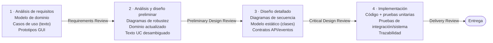

# Cómo aplicamos ICONIX en Bandada U

ICONIX es un proceso ligero dirigido por casos de uso que pasa del requisito al código
con **cuatro diagramas** (dominio, casos de uso, robustez, secuencia) y **revisiones
formales** entre fases. Lo elegimos porque deja trazabilidad completa y porque cada caso
de uso es una unidad de trabajo que un agente de IA puede tomar en una sesión.

## 1. Fases, artefactos e hitos



| Fase | Artefactos (dónde viven) | Criterio de salida (hito) |
|---|---|---|
| 1. Requisitos | `01-requisitos/*`, `02-modelo-dominio.md`, `03-casos-de-uso/00-catalogo.md`, sección **1** de cada `UC-xx.md`, `05-prototipos-gui.md` | **RR**: todo requisito funcional tiene ≥1 UC; cada UC tiene curso básico y alternos; nombres de clases salen del dominio |
| 2. Análisis | Sección **2** (robustez) de cada `UC-xx.md`; dominio actualizado | **PDR**: cada paso del texto aparece en el diagrama de robustez; reglas de robustez cumplidas; entidades nuevas agregadas al dominio |
| 3. Diseño | Sección **3** (secuencia) y **4** (clases) de cada `UC-xx.md`; `06-modelo-estatico/*`; `bandadau-docs/contracts/*` | **CDR**: cada controlador de robustez se convirtió en ≥1 mensaje; cada mensaje que cruza servicios existe en un contrato |
| 4. Implementación | Código en `bandadau-backend/services/*`, `bandadau-frontend/`, `bandadau-admin/*`, `bandadau-landing/`; sección **5** (pruebas) de cada UC; `07-trazabilidad.md` | **DR**: pruebas de aceptación del UC pasan; matriz de trazabilidad completa |

Las listas de verificación de cada hito están en `08-revisiones.md`.

## 2. Reglas del diagrama de robustez (las verificamos en la PDR)

Estereotipos: **Actor**, **Boundary** (pantalla / endpoint / cola), **Control**
(lógica, un verbo del texto), **Entity** (objeto del dominio).

1. Actores solo hablan con *boundaries*.
2. *Boundaries* solo hablan con actores y *controls*.
3. *Entities* solo hablan con *controls*.
4. *Controls* hablan con *boundaries*, *entities* y otros *controls* (nunca actor ↔ control).
5. Sustantivos del texto → boundaries/entities; verbos → controls.
6. Si un paso del texto no aparece en el diagrama (o al revés), se corrige el **texto**.

**Notación normativa (ICONIX clásico, no UML).** El diagrama de robustez formal es un artefacto de
análisis de ICONIX, no un diagrama UML: el tipo de cada elemento lo da su símbolo nativo, no una
etiqueta `«boundary»` ni una flecha de flujo. Se dibuja con los símbolos clásicos:

| Elemento | Símbolo | Uso |
|---|---|---|
| Actor | figura de palo | Persona o sistema externo que interactúa con el caso |
| Boundary | círculo con barra vertical a la izquierda | Pantalla, endpoint, cola, correo, broker |
| Control | círculo con flecha curva en la parte superior | Lógica de un verbo del texto |
| Entity | círculo con línea horizontal debajo | Objeto del dominio persistente o en memoria |

Las asociaciones son **líneas simples** (comunicación), no flechas de flujo. El **curso alterno**
se dibuja en **rojo** y el curso básico en negro. En la vista rápida de Mermaid —que no tiene esos
símbolos— los estereotipos `«actor»`, `«boundary»`, `«control»` y `«entity»` son los marcadores que
consume el generador de Enterprise Architect (`entregable/ea/`), que crea un **Actor** y objetos UML
con estereotipos **EAUML::boundary**, **EAUML::control** y **EAUML::entity**; las formas de Mermaid
son solo una aproximación.
El piloto es [UC-14](03-casos-de-uso/UC-14-validar-entrada.md); su vista ilustrada (simplificada) está en
[`UC-14-robustez.svg`](03-casos-de-uso/img/UC-14-robustez.svg). Los bloques Mermaid que aún quedan
en otros UC son borradores heredados y se migrarán a este formato.

## 3. Plantilla obligatoria de un caso de uso

Cada caso vive en `03-casos-de-uso/UC-XX-slug.md` y crece fase a fase:

```markdown
# UC-XX — Nombre en infinitivo

| Campo | Valor |
|---|---|
| Paquete | Identidad / Social / Eventos / Billetera / IA / Admin / Automatización |
| Actor principal | ... |
| Actores secundarios | servicios / sistemas externos |
| Prioridad (MoSCoW) | Must |
| Requisitos | RF-xx, RNF-xx |
| Tecnologías de la cátedra que demuestra | T8, C1 ... |
| Servicios involucrados | events-service, wallet-service ... |
| Estado ICONIX | Requisitos / Robustez / Secuencia / Implementado |

## 1. Narrativa (fase de requisitos)
Precondiciones · Disparador · Curso básico (pasos numerados, voz activa,
"El sistema ..." / "El estudiante ...", nombres del dominio) · Cursos alternos
(numerados por paso: 4a, 4b) · Postcondiciones · Reglas de negocio.

## 2. Diagrama de robustez (fase de análisis)
Mermaid + tabla "objeto → tipo → componente real".

## 3. Diagrama de secuencia (fase de diseño)
Mermaid `sequenceDiagram` con participantes = componentes reales (pantalla, gateway,
controller, use case, repositorio, broker...). Curso básico + al menos el alterno
más importante.

## 4. Clases / contratos involucrados
Clases por servicio (respetando su arquitectura) + operaciones de contrato
(`operationId` de OpenAPI, tipos de eventos AsyncAPI, campos GraphQL).

## 5. Pruebas de aceptación
Escenarios Given/When/Then que cubren curso básico y alternos.

## 6. Trazabilidad
RF → este UC → endpoints/eventos → clases → pruebas.
```

## 4. Cómo trabaja un agente de IA con ICONIX

1. Leer el `AGENTS.md` del workspace → `catalogo-servicios.md` → el UC asignado.
2. **No implementar** un UC cuyo estado sea anterior a "Secuencia": primero completar
   la fase faltante y marcarla para revisión.
3. Si al implementar aparece algo que no está en la secuencia, **se actualiza el UC y
   el contrato primero**, luego el código (contract-first).
4. Al terminar: actualizar estado del UC, `07-trazabilidad.md` y
   `bandadau-docs/docs/06-plan/registro-de-sesiones.md`.
