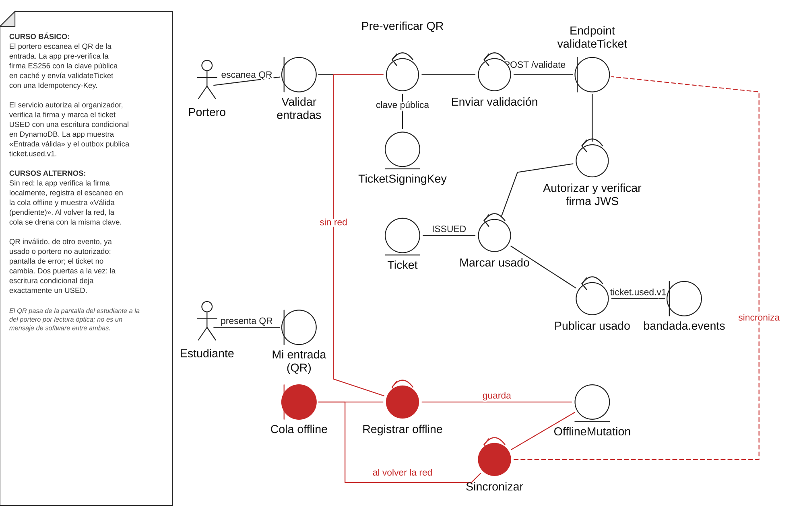
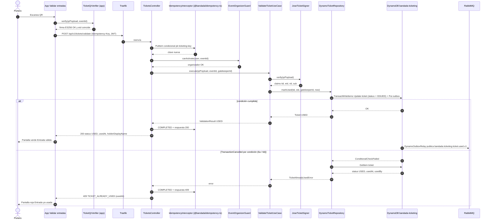
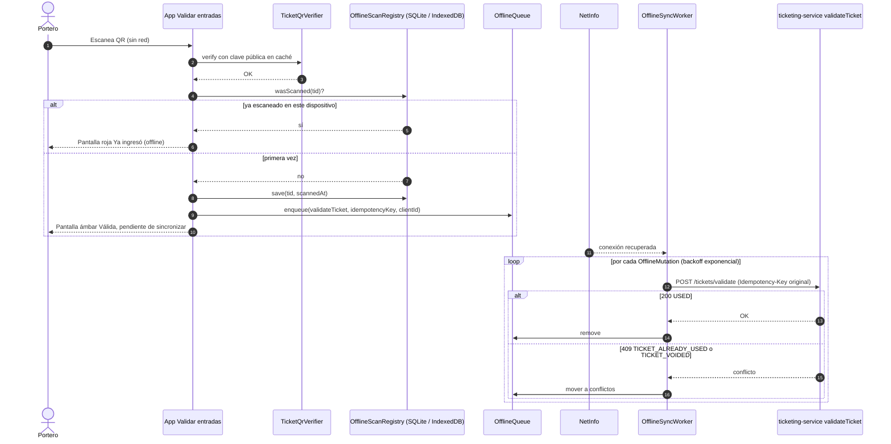

# UC-14 — Validar entrada en la puerta

| Campo | Valor |
|---|---|
| Paquete | Eventos |
| Actor principal | Portero (Organizador del evento o staff con rol `ORGANIZER`) |
| Actores secundarios | Estudiante (presenta el QR), `ticketing-service`, `insights-service` / `notification-service` (consumidores del evento) |
| Prioridad (MoSCoW) | Must |
| Requisitos | RF-18, RNF-05, RNF-09, RNF-01 |
| Tecnologías de la cátedra que demuestra | T4 (REST), **T8** (idempotencia + escritura condicional DynamoDB), T7 (modo offline del portero) |
| Servicios involucrados | `ticketing-service` (NestJS 11, Clean, DynamoDB `bandada-ticketing`), `bandadau-frontend` |
| Estado ICONIX | Implementado (fase 1, 2026-10-15) (backend; validación en puerta desde la app Expo a cargo del equipo) — evidencia en `../07-trazabilidad.md` |

## 1. Narrativa (fase de requisitos)

### Precondiciones

1. El estudiante tiene un `Ticket` `ISSUED` (UC-12) y lo muestra en *Mi entrada* como código QR.
   El QR contiene el `qrPayload` devuelto por `getTicket`.
2. El portero tiene sesión en la app con rol `ORGANIZER` y es organizador del `Event` (o fue
   designado como staff de ese evento, ver PROPUESTA 3).
3. El portero abrió la pantalla *Validar entradas* del evento, que descargó la **clave pública
   de firma** de tickets para el modo offline (paso opcional).

### Disparador

El portero escanea el QR del estudiante con la cámara (`expo-camera`).

### Formato del QR (decisión de diseño)

`qrPayload` es un **JWS compacto firmado con ES256** (clave privada solo en `ticketing-service`,
`kid` rotable). Se elige firma **asimétrica** en lugar de HMAC porque el modo offline exige que
el dispositivo del portero **verifique sin poseer el secreto**; con HMAC, distribuir la clave a
cada portero permitiría falsificar entradas. Claims mínimos:

| Claim | Valor |
|---|---|
| `tid` | `ticketId` (UUIDv7) |
| `eid` | `eventId` |
| `rid` | `registrationId` |
| `sub` | `userId` del titular |
| `iat` | emisión (epoch s) |
| header `kid` | identificador de la clave de firma |

El QR **no** lleva estado (`ISSUED`/`USED`): el estado vive solo en DynamoDB; la firma prueba
autenticidad, la escritura condicional prueba unicidad.

### Curso básico (en línea)

1. El portero escanea el QR. La app extrae el `qrPayload`.
2. La app hace una **pre-verificación local**: firma ES256 válida con la clave pública en caché y
   `eid` igual al evento abierto. Si pasa, muestra "Validando…".
3. La app genera un `Idempotency-Key` **por escaneo** y envía
   `POST /api/v1/tickets/validate` (`validateTicket`) con `{ qrPayload }` (y `eventId` del evento abierto).
4. El sistema verifica que el portero tiene rol `ORGANIZER` y es organizador del evento.
5. El sistema verifica la firma JWS (con el `kid` del header) y que `eid` coincide con el evento.
6. El sistema ejecuta en DynamoDB una **escritura condicional** sobre
   `pk = TICKET#<tid>`, `sk = META`: `SET status = USED, usedAt = now, usedBy = <porteroId>` con
   `ConditionExpression: status = ISSUED AND eventId = :eid`, junto con el registro del evento en el
   outbox (`TransactWriteItems`).
7. El sistema responde **200** `{ ticketId, status: USED, usedAt, holderDisplayName }`.
8. La app muestra la pantalla verde "Entrada válida" con el nombre del titular y vibra.
9. El relay del outbox publica `bandada.ticketing.ticket.used.v1` (`ticketId`, `eventId`, `userId`,
   `usedAt`), que `insights-service` proyecta como métrica de asistencia.

### Cursos alternos

- **2a. Firma inválida o QR ilegible** (pre-verificación local): la app muestra pantalla roja
  "QR no válido" sin llamar al servidor. Fin.
- **2b. QR de otro evento** (`eid` distinto): pantalla roja "Esta entrada es de otro evento". Fin.
- **3a. Doble lectura del mismo escaneo / reintento de red con la misma clave**: la capa de
  idempotencia (`bandada-idempotency`, prefijo `ticketing#`) devuelve la misma respuesta 200 con
  `Idempotent-Replayed: true`. La app sigue mostrando "Entrada válida".
- **4a. El usuario no es organizador del evento**: `403` (`code: NOT_EVENT_ORGANIZER`). Fin.
- **5a. Firma inválida en servidor** (p. ej. clave rotada y caché local vieja): `422`
  (`code: INVALID_QR_SIGNATURE`); la app refresca la clave pública.
- **6a. Ticket ya `USED`** (falla la condición): el sistema lee el ítem y responde `409`
  (`code: TICKET_ALREADY_USED`) con `usedAt` y `usedBy`. La app muestra pantalla roja "Entrada ya
  usada a las HH:mm". Si `usedBy` es el mismo portero y `usedAt` hace < 10 s (re-escaneo con otra
  clave), muestra en ámbar "Ya validaste esta entrada".
- **6b. Ticket `VOIDED`** (cancelada en UC-13 o SAGA compensada): `409` (`code: TICKET_VOIDED`). Pantalla roja.
- **6c. Ticket inexistente** (firma válida pero sin ítem: datos borrados o entorno distinto): `404`.
- **6d. Dos puertas escanean a la vez el mismo QR**: DynamoDB serializa las dos escrituras
  condicionales; exactamente una gana (200) y la otra recibe 6a (409). No hay doble ingreso.
- **3b. Sin red (modo offline del portero)**:
  1. La app verifica la firma con la clave pública en caché y `eid`.
  2. Consulta su registro local de escaneos del evento (`expo-sqlite` / IndexedDB); si el `tid` ya fue
     escaneado en este dispositivo, pantalla roja "Ya ingresó (offline)".
  3. Si no, guarda el escaneo como `OfflineMutation` (`validateTicket`, `idempotencyKey`, `clientId`
     UUIDv7, `scannedAt`) y muestra pantalla **ámbar** "Válida (pendiente de sincronizar)".
  4. Al volver la red, la cola se drena con backoff; cada mutación usa su `Idempotency-Key`
     original. Si el servidor responde 409 `TICKET_ALREADY_USED` (otra puerta la validó antes), la
     app lo registra como **conflicto** y lo lista en "Conflictos de sincronización" para el organizador.
  - Limitación aceptada: offline no se detectan duplicados **entre dispositivos** hasta sincronizar.
- **7a. Error 5xx o timeout**: la app reintenta 2 veces con la misma clave; si falla, ofrece pasar
  a modo offline (3b).

### Postcondiciones

- **Éxito**: `Ticket.status = USED`, `usedAt` registrado; evento `bandada.ticketing.ticket.used.v1`
  publicado una sola vez.
- **Fallo**: el ticket no cambia. Un ticket `USED` o `VOIDED` nunca vuelve a cambiar (invariante 5).

### Reglas de negocio

- **RN-14.1** Un ticket se marca `USED` una sola vez (RF-18), garantizado por la condición
  `status = ISSUED` en DynamoDB, no por la app.
- **RN-14.2** Solo el organizador del evento (o su staff) valida tickets de ese evento.
- **RN-14.3** La validación se acepta desde `startsAt − 2 h` hasta el fin del evento (PROPUESTA 5);
  fuera de esa ventana `422 VALIDATION_WINDOW_CLOSED`. Esto además impide que un ticket se use
  dentro de la ventana de cancelación de UC-13.
- **RN-14.4** El QR no contiene datos personales más allá de IDs; el nombre del titular se obtiene
  del servidor (o de la lista descargada) solo para el portero.

## 2. Diagrama de robustez (fase de análisis)

*Figura — Diagrama de robustez de UC-14 con notación ICONIX (curso alterno «sin red» en rojo).*

> **Notación ICONIX (no UML).** Actor = figura de palo; boundary = círculo con barra vertical;
> control = círculo con flecha curva; entity = círculo con línea horizontal. Las líneas son
> asociaciones de comunicación, no flechas de flujo. El curso alterno «sin red» se dibuja en rojo.
> El QR pasa de la pantalla del estudiante a la del portero por lectura óptica: no es un mensaje
> de software entre ambas pantallas.

| Objeto | Tipo | Componente real |
|---|---|---|
| Pantalla Mi entrada (QR) | Boundary | `bandadau-frontend/app/(tabs)/tickets/[registrationId].tsx` (`react-native-qrcode-svg` o equivalente) |
| Pantalla Validar entradas | Boundary | `bandadau-frontend/app/organizer/events/[eventId]/scan.tsx` (`expo-camera`) |
| Endpoint validateTicket | Boundary | `ticketing-service` → `TicketsController` |
| Cola offline del dispositivo | Boundary | `OfflineQueue` (`expo-sqlite` nativo / IndexedDB web) |
| Exchange `bandada.events` | Boundary | RabbitMQ |
| Leer y pre-verificar QR | Control | `TicketQrVerifier` (app, usa `jose`/WebCrypto según plataforma) |
| Enviar validación, Sincronizar cola | Control | `useValidateTicket` + `OfflineSyncWorker` (app) |
| Autorizar organizador | Control | `EventOrganizerGuard` (ticketing, interface adapters) |
| Verificar firma JWS | Control | `TicketSigner` (puerto) → `JoseTicketSigner` (adaptador) |
| Marcar ticket usado | Control | `ValidateTicketUseCase` |
| Publicar ticket usado | Control | `DynamoOutboxRelay` |
| Registrar escaneo offline | Control | `OfflineScanRegistry` (app) |
| Ticket | Entity | `bandada-ticketing` (`TICKET#<ticketId>` / `META`) |
| TicketSigningKey | Entity | Par ES256: privada en Secrets Manager / `.env` dev; pública expuesta (PROPUESTA 1) y cacheada en la app |
| OfflineMutation | Entity | Tabla local `offline_mutations` de la app |

## 3. Diagrama de secuencia (fase de diseño)

### 3.1 Curso básico (en línea) y alterno 6a/6d

### 3.2 Curso alterno 3b (offline) y sincronización

## 4. Clases / contratos involucrados

### ticketing-service (NestJS 11, Clean Architecture)

| Capa | Clase | Responsabilidad |
|---|---|---|
| `domain` | `Ticket` (entidad) | `markUsed(by, at)`: lanza `TicketAlreadyUsedError` / `TicketVoidedError` si no está `ISSUED` |
| `domain` | `TicketStatus` | `ISSUED`, `USED`, `VOIDED` |
| `domain` | `QrClaims` (value object) | `tid`, `eid`, `rid`, `sub`, `iat` |
| `application` | `ValidateTicketUseCase` | Orquesta verificación, transición y outbox |
| `application/ports` | `TicketRepository`, `TicketSigner`, `Clock` | Puertos de salida |
| `infrastructure` | `DynamoTicketRepository` | `TransactWriteItems` con `ConditionExpression` |
| `infrastructure` | `JoseTicketSigner` | Firma/verifica ES256 con `jose`; resuelve `kid` |
| `infrastructure` | `DynamoOutboxRelay` | Publica a `bandada.events` (CloudEvents) |
| `interface` | `TicketsController`, `EventOrganizerGuard`, `IdempotencyInterceptor` | HTTP, autorización, idempotencia |

### bandadau-frontend

`TicketQrVerifier`, `OfflineScanRegistry`, `OfflineQueue` / `OfflineSyncWorker` (D6),
hook `useValidateTicket`, pantalla `scan.tsx`.

### Contratos

| Tipo | Identificador | Contrato |
|---|---|---|
| REST | `validateTicket` — `POST /api/v1/tickets/validate` ♻️, body `{ qrPayload }` → 200 | `bandadau-docs/contracts/openapi/ticketing-service.yaml` |
| REST | `getTicket` (incluye `qrPayload`), `listMyTickets` | ídem |
| Evento | `bandada.ticketing.ticket.used.v1` | `bandadau-docs/contracts/asyncapi/bandada-events.yaml` |
| Errores | `TICKET_ALREADY_USED` (409), `TICKET_VOIDED` (409), `INVALID_QR_SIGNATURE` (422), `NOT_EVENT_ORGANIZER` (403), `TICKET_NOT_FOUND` (404), `IDEMPOTENCY_IN_PROGRESS` (409) | Problem Details |

## 5. Pruebas de aceptación

| ID | Escenario (Given / When / Then) |
|---|---|
| AT-14-01 | **Given** un ticket `ISSUED` del evento E y un portero organizador de E **When** escanea el QR en línea **Then** recibe 200 `USED`, el ítem en DynamoDB tiene `usedAt` y se publica una vez `ticket.used.v1`. |
| AT-14-02 | **Given** un ticket ya `USED` **When** otro escaneo con nueva clave lo valida **Then** 409 `TICKET_ALREADY_USED` con `usedAt`. |
| AT-14-03 | **Given** un ticket `ISSUED` **When** dos peticiones concurrentes con claves distintas lo validan **Then** exactamente una recibe 200 y la otra 409. |
| AT-14-04 | **Given** una validación exitosa **When** se reenvía con la misma `Idempotency-Key` **Then** 200 con `Idempotent-Replayed: true` y sin segundo evento. |
| AT-14-05 | **Given** un QR con la firma alterada (un byte cambiado) **When** se valida **Then** la app lo rechaza localmente y el servidor responde 422 `INVALID_QR_SIGNATURE`. |
| AT-14-06 | **Given** un ticket `VOIDED` (UC-13) **When** se valida **Then** 409 `TICKET_VOIDED`. |
| AT-14-07 | **Given** un organizador de otro evento **When** valida el ticket **Then** 403 `NOT_EVENT_ORGANIZER`. |
| AT-14-08 | **Given** el dispositivo en modo avión con clave pública en caché **When** escanea un QR válido dos veces **Then** la primera queda ámbar (pendiente) y la segunda roja; al reconectar se envía una sola petición y el ticket queda `USED`. |
| AT-14-09 | **Given** dos dispositivos offline que escanean el mismo QR **When** ambos sincronizan **Then** uno queda `USED` y el otro registra un conflicto visible. |
| AT-14-10 | **Given** 100 validaciones concurrentes **When** se mide **Then** p95 < 600 ms (RNF-01). |

## 6. Trazabilidad

| Requisito | UC | Endpoints / mensajes | Clases | Pruebas |
|---|---|---|---|---|
| RF-18 | UC-14 | `validateTicket`, `getTicket`, `ticket.used.v1` | `Ticket`, `ValidateTicketUseCase`, `JoseTicketSigner`, `DynamoTicketRepository` | AT-14-01…07 |
| RNF-05 / T8 | UC-14 | `Idempotency-Key`, condición `status = ISSUED` | `IdempotencyInterceptor`, `DynamoTicketRepository` | AT-14-03, 04 |
| RNF-09 / T7 | UC-14 | `OfflineMutation` | `OfflineQueue`, `OfflineScanRegistry` | AT-14-08, 09 |
| RNF-01 | UC-14 | — | — | AT-14-10 |

### PROPUESTAS (pendientes de aprobar; agregar a `decisiones-clave.md` / contratos)

> **Resolución en la fase 1 (2026-10-15):** las propuestas 1, 2, 3 y 5 quedaron incorporadas a los contratos (`getTicketSigningKeys`, `eventId` opcional, `organizerId`/`staffUserIds`/`eventEndsAt` en `issue-ticket` — AsyncAPI 1.2.0 —, y `VALIDATION_WINDOW_CLOSED` 422 / `TICKET_NOT_FOUND` 404 — OpenAPI ticketing 1.2.0).

1. Endpoint público `GET /api/v1/tickets/signing-keys` (`getTicketSigningKeys`, formato JWKS) para la
   verificación offline; y fijar en D1 que `qrPayload` es **JWS ES256** (no HMAC).
2. Campo `eventId` opcional en el body de `validateTicket` (`{ qrPayload, eventId }`) para el chequeo de evento esperado.
3. `organizerId` (y lista opcional de `staffUserIds`) en el comando `bandada.ticketing.cmd.issue-ticket.v1`,
   copiado al ítem del ticket para que `EventOrganizerGuard` autorice sin consultar `events-service`.
4. Patrón de ítem de outbox en `bandada-ticketing`: `pk = OUTBOX#<messageId>` (escrito en la misma
   `TransactWriteItems`), a reflejar en `catalogo-servicios.md` §6 (requiere ADR por tocar el catálogo).
5. Ventana de validación `startsAt − 2 h … fin del evento` y código `VALIDATION_WINDOW_CLOSED`.
6. Endpoint `GET /api/v1/tickets?eventId=` (`listEventTickets`, rol organizador) para precargar la
   lista de titulares en modo offline (opcional).
