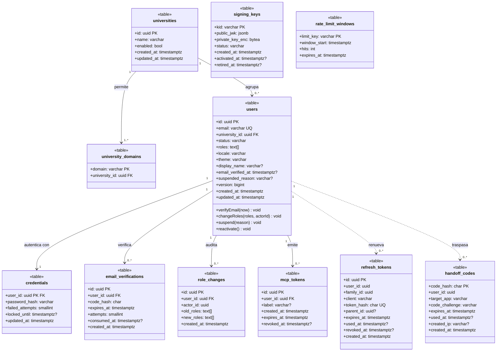
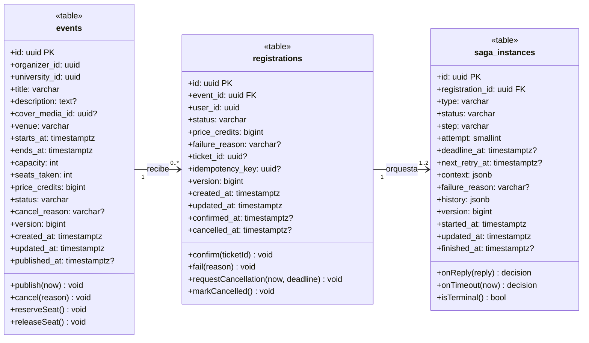
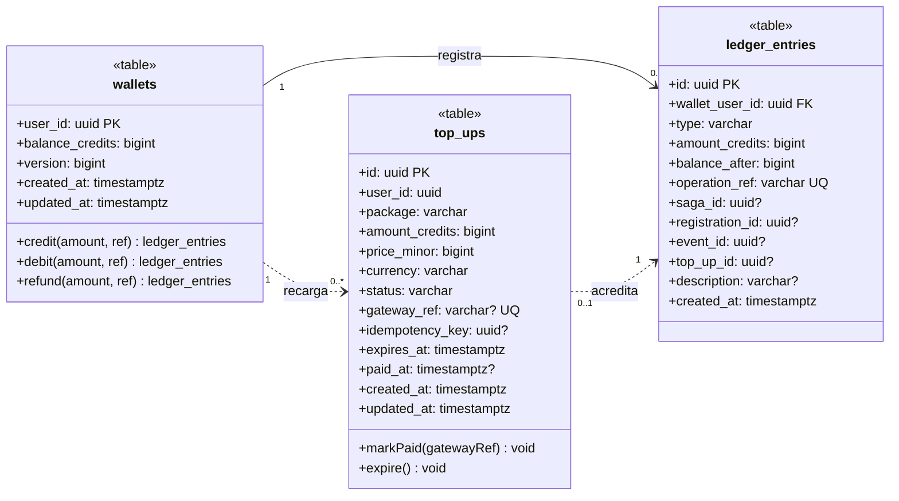
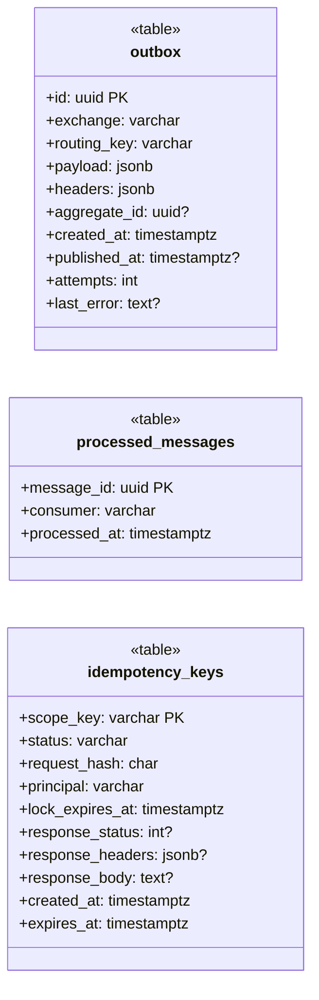
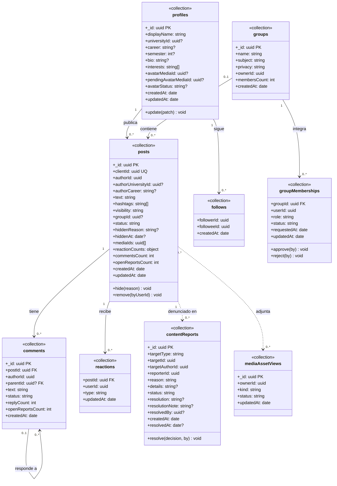
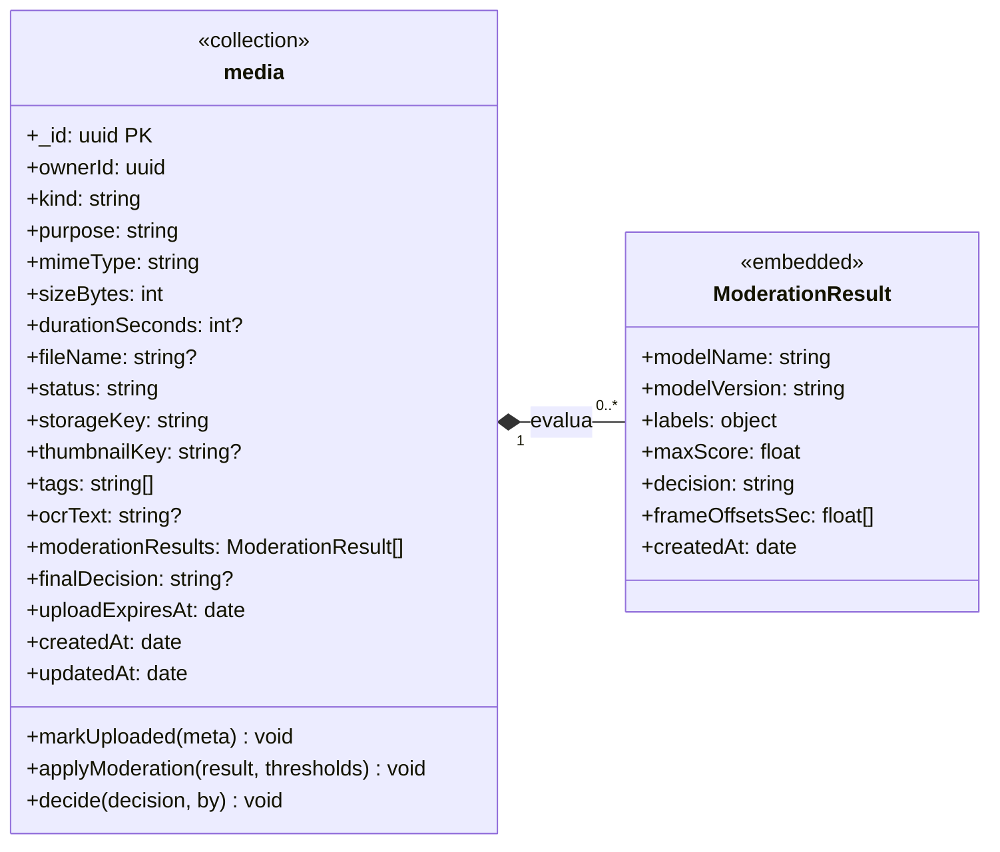
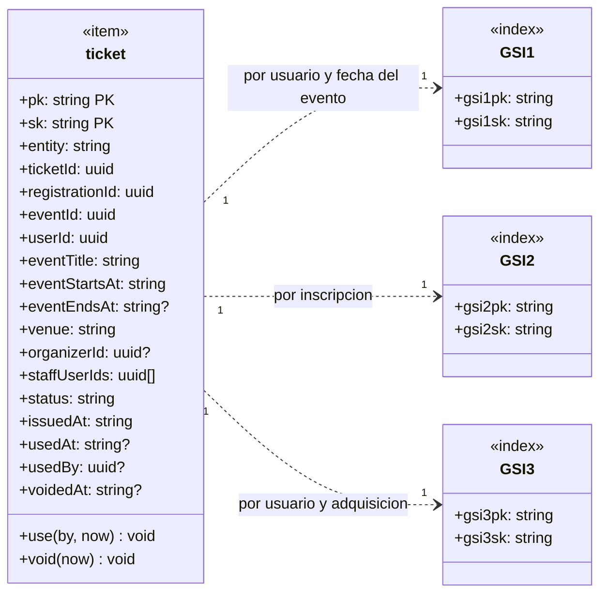
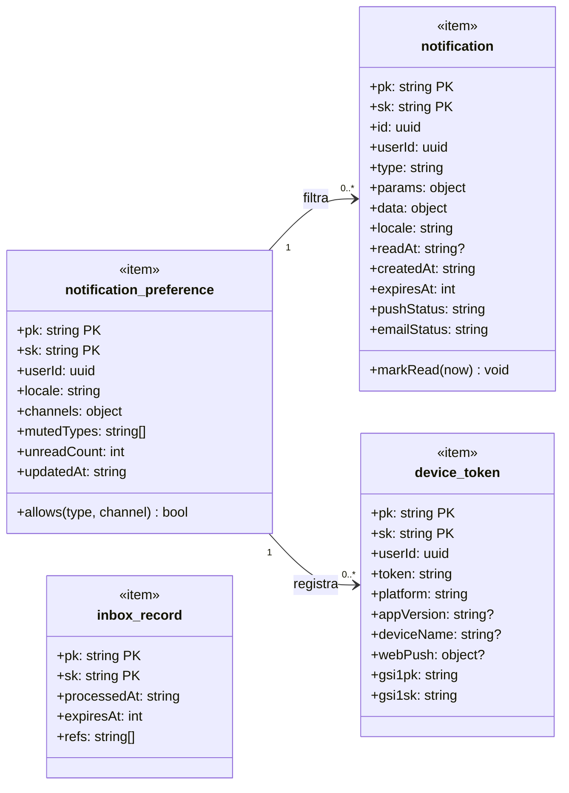
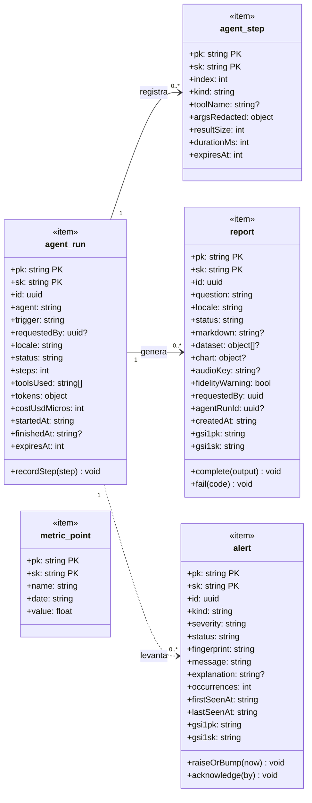
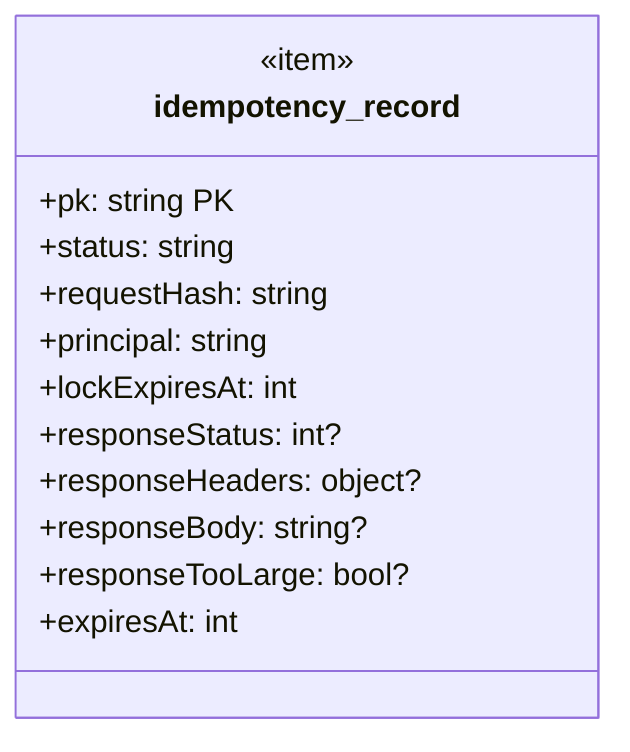

# Modelo de datos — diagramas de clases UML por base de datos

Diagramas de clases (UML 2.5) **derivados de las tablas, colecciones e ítems reales** de cada base de datos de Bandada U.
Cada tabla, colección o ítem es una clase con su estereotipo (`«table»`, `«collection»`, `«item»`, `«index»`);
las asociaciones llevan nombre y multiplicidad. La fuente de cada esquema es el código desplegado:

| Base | Motor | Servicio | Fuente del esquema |
|---|---|---|---|
| `identity_db` | PostgreSQL | `identity-service` | `src/main/resources/db/migration/V1..V3` (Flyway) |
| `events_db` | PostgreSQL | `events-service` | `src/main/resources/db/migration/V1..V2` (Flyway) |
| `wallet_db` | PostgreSQL | `wallet-service` | `database/migrations/2026_10_14_000001_create_wallet_tables.php` |
| `social` | MongoDB | `social-service` | repositorios Mongo e `indexes.ts` |
| `media` | MongoDB | `media-service` | `mongo-media.repository.ts` |
| `bandada-ticketing` | DynamoDB | `ticketing-service` | `dynamo-ticket.repository.ts` |
| `bandada-notifications` | DynamoDB | `notification-service` | `Dynamo*Repository.php` |
| `bandada-insights` | DynamoDB | `insights-service` | `dynamo-repositories.ts` |
| `bandada-idempotency` | DynamoDB | compartida | `@bandada/idempotency-ts` (`stores/dynamodb.ts`) |

**Convenciones.** `PK` clave primaria, `FK` clave foránea, `UQ` único, `?` nulo permitido. Los tipos van sin longitud
(`varchar`, no `varchar(160)`). En MongoDB, `_id` es la clave y los objetos incrustados se dibujan como composición
(rombo relleno). En DynamoDB, `pk`/`sk` son la clave compuesta y los índices secundarios globales (GSI) se muestran como
clases `«index»`. Las operaciones son las del dominio (ver los modelos estáticos de cada servicio). **Regla del proyecto:
una base no se lee desde otro servicio**, por eso las referencias entre bases (`user_id`, `event_id`) son identificadores
lógicos sin clave foránea y no se dibujan como asociación.

---

## Identidad — `identity_db` (PostgreSQL)

---

## Eventos — `events_db` (PostgreSQL)

---

## Billetera — `wallet_db` (PostgreSQL)

---

## Soporte común — outbox, inbox e idempotencia (PostgreSQL)

Las tres bases de PostgreSQL llevan `outbox` y `processed_messages` (inbox); `identity_db` y `events_db` agregan además
`idempotency_keys`. En `wallet_db` la idempotencia de las peticiones vive en DynamoDB.

---

## Social — `social` (MongoDB)

---

## Medios — `media` (MongoDB)

---

## Entradas — `bandada-ticketing` (DynamoDB)

---

## Notificaciones — `bandada-notifications` (DynamoDB)

---

## Insights — `bandada-insights` (DynamoDB)

---

## Idempotencia compartida — `bandada-idempotency` (DynamoDB)

