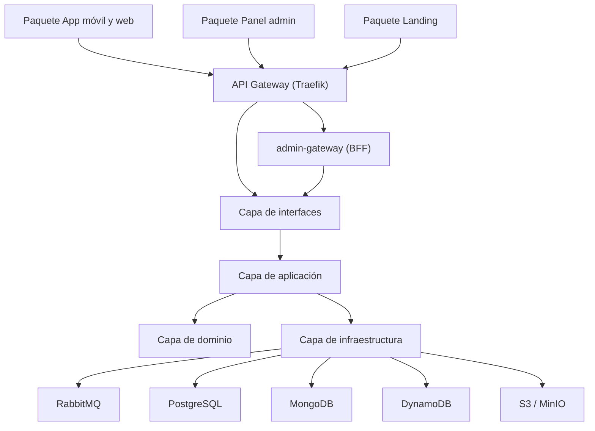

# Diseño lógico: arquitectura en capas — Bandada U

Vista de **paquetes** (UML 2.5) del diseño lógico. Acompaña al diagrama de despliegue
(`docs/05-infraestructura/infraestructura.md`, §4.6) y a la vista de contenedores
(`arquitectura-general.md`, §2). Cada flecha punteada es una dependencia: el paquete de origen usa al de destino.

Las cuatro capas internas de un servicio (Interfaces, Aplicación, Dominio, Infraestructura) se materializan
según la arquitectura asignada en `catalogo-servicios.md`: Hexagonal (identity, wallet), Clean
(social, media, ticketing, notification, insights) y DDD (events).

## 1. Diseño lógico organizado en capas

| Paquete | Contenido |
|---|---|
| Paquete App móvil y web | App Expo SDK 57 (iOS, Android y PWA) con IA local |
| Paquete Panel de administración | Shell Next.js y microfrontends de moderación (Angular) e insights (React) |
| Paquete Landing | Sitio estático Next.js |
| API Gateway (Traefik) | Enrutamiento, TLS, JWT y bloqueo de `/internal/**` |
| admin-gateway (BFF GraphQL) | Resolvers y data sources que consultan los servicios por REST interno |
| Capa de interfaces | Controladores REST, herramientas MCP y consumidores de mensajes de los 8 servicios |
| Capa de aplicación | Casos de uso, DTO y puertos (interfaces de repositorio y publicador) |
| Capa de dominio | Entidades, objetos de valor y reglas; no importa frameworks |
| Capa de infraestructura | Adaptadores de persistencia, outbox/inbox y clientes externos |
| RabbitMQ, PostgreSQL, MongoDB, DynamoDB, S3 / MinIO | Mensajería y almacenes (una base por servicio) |
