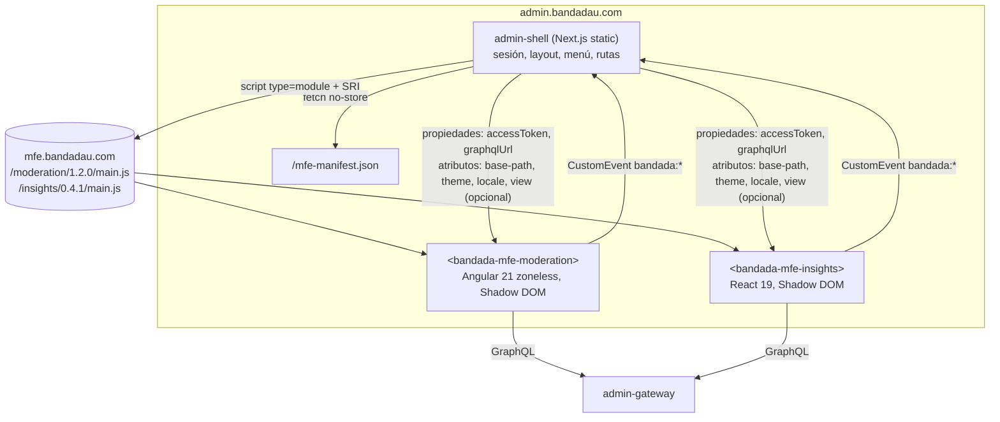

# Microfrontends del panel (T2)

> Detalle de **D5**, con los añadidos de **D13** (tokens y temas) y **D14** (i18n).
> Componentes: F2 `admin-shell` (Next.js 16 static export), F3 `mfe-moderation`
> (Angular 21 + Angular Elements), F4 `mfe-insights` (React 19 + Vite). Datos:
> `graphql-admin.md`. Tokens: `seguridad-y-sso.md` §5.

## 1. Decisión: Web Components en runtime



| Criterio | Web Components en runtime (elegido) | Module Federation |
|---|---|---|
| Frameworks distintos (Angular + React + shell Next.js) | Nativo: el contrato es el DOM | Posible, pero exige el mismo bundler/plugin en los tres (Next 16 + Angular CLI esbuild + Vite) y adaptadores |
| Compatibilidad con `output: 'export'` de Next.js | Total: solo inyecta un `<script>` | Next.js no soporta oficialmente MF con App Router; el plugin está en mantenimiento |
| Aislamiento de estilos | Shadow DOM | Manual (CSS Modules, prefijos) |
| Dependencias compartidas | No (cada MFE trae las suyas) → bundles más grandes | Sí (`shared`) → menor peso, pero acoplamiento de versiones |
| Despliegue independiente | Sí, versión en el manifiesto | Sí, `remoteEntry.js` |
| Contrato explícito | Atributos, propiedades y eventos tipados | Imports de módulos JS (acopla APIs internas) |
| Demostración en la defensa | Se ve en DevTools: dos custom elements de frameworks distintos | Menos visible |

Costo aceptado: el MFE Angular y el React empaquetan su framework (~100–150 KB gzip
cada uno). Para un panel interno es aceptable.

## 2. `mfe-manifest.json`

Servido por el shell (`bandadau-admin/shell/public/mfe-manifest.json` en dev; generado
por el pipeline de despliegue en prod) con `Cache-Control: no-store`. Forma de D5,
con campos opcionales adicionales:

```json
{
  "moderation": {
    "url": "https://mfe.bandadau.com/moderation/1.2.0/main.js",
    "element": "bandada-mfe-moderation",
    "version": "1.2.0",
    "integrity": "sha384-…",
    "requiredRoles": ["MODERATOR", "ADMIN"],
    "basePath": "/moderation"
  },
  "insights": {
    "url": "https://mfe.bandadau.com/insights/0.4.1/main.js",
    "element": "bandada-mfe-insights",
    "version": "0.4.1",
    "integrity": "sha384-…",
    "requiredRoles": ["ADMIN"],
    "basePath": "/insights"
  }
}
```

JSON Schema (`bandadau-docs/contracts/mfe/mfe-manifest.schema.json`):

```json
{
  "$schema": "https://json-schema.org/draft/2020-12/schema",
  "type": "object",
  "additionalProperties": {
    "type": "object",
    "required": ["url", "element", "version"],
    "properties": {
      "url": { "type": "string", "format": "uri" },
      "element": { "type": "string", "pattern": "^bandada-mfe-[a-z0-9-]+$" },
      "version": { "type": "string", "pattern": "^\\d+\\.\\d+\\.\\d+(-[0-9A-Za-z.-]+)?$" },
      "integrity": { "type": "string", "pattern": "^sha(256|384|512)-" },
      "requiredRoles": { "type": "array", "items": { "enum": ["STUDENT", "ORGANIZER", "MODERATOR", "ADMIN"] } },
      "basePath": { "type": "string", "pattern": "^/[a-z0-9-]+$" }
    },
    "additionalProperties": false
  }
}
```

`requiredRoles` solo oculta menú y ruta (UX); la autorización real la hace el gateway (`@auth`).

## 3. Contrato shell ↔ MFE

| Entrada | Tipo | Forma | Notas |
|---|---|---|---|
| `graphqlUrl` / `graphql-url` | string | propiedad o atributo | `https://api.<dominio>/graphql` |
| `accessToken` | string | **solo propiedad** | Nunca atributo (quedaría en el DOM, visible en DevTools/extensiones y en `outerHTML`) |
| `base-path` | string | atributo | `/moderation`; el MFE resuelve sus rutas relativas a esto |
| `theme` | `light` \| `dark` | atributo | Tema **resuelto** (nunca `SYSTEM`; el shell resuelve, D13) |
| `locale` | `es` \| `en` | atributo | D14 |
| `view` | `summary` \| `detail` | atributo (opcional) | Vista gerencial o completa. Opcional: sin el atributo el MFE usa `detail`, así que los shells anteriores siguen funcionando. Hoy lo usa `insights`; el shell recuerda la elección del usuario |

| Evento (MFE → shell) | `detail` | Acción del shell |
|---|---|---|
| `bandada:navigate` | `{ path: string, replace?: boolean }` | `router.push(basePath + path)` |
| `bandada:toast` | `{ kind: 'success'\|'error'\|'info', messageKey?: string, message?: string }` | Muestra toast del shell |
| `bandada:auth-expired` | `{}` | Refresh single-flight → reasigna `accessToken` a todos los MFEs; si falla, logout |

| Evento (shell → MFE) | `detail` | Alternativa equivalente |
|---|---|---|
| `bandada:theme-changed` | `{ theme: 'light'\|'dark' }` | Cambio del atributo `theme` |
| `bandada:locale-changed` | `{ locale: 'es'\|'en' }` | Cambio del atributo `locale` |

El shell **siempre** actualiza el atributo y además despacha el evento sobre el
elemento. Los MFEs DEBEN reaccionar al atributo (`observedAttributes` /
`attributeChangedCallback` o input de Angular); el evento es para lógica que no
depende del render (p. ej. recargar un gráfico Vega-Lite).

Todos los `CustomEvent` hacia el shell DEBEN crearse con `{ bubbles: true, composed: true }`
para atravesar el Shadow DOM. Nada de estado global compartido (`window.*`,
`localStorage` compartido, stores globales).

Tipos en `bandadau-shared/packages/contracts-ts/src/mfe.ts`:

```ts
export interface BandadaMfeElement extends HTMLElement {
  accessToken: string | null;
  graphqlUrl: string;
}
export interface BandadaMfeEvents {
  'bandada:navigate': CustomEvent<{ path: string; replace?: boolean }>;
  'bandada:toast': CustomEvent<{ kind: 'success' | 'error' | 'info'; messageKey?: string; message?: string }>;
  'bandada:auth-expired': CustomEvent<Record<string, never>>;
}
```

## 4. Carga dinámica en el shell (Next.js 16, static export)

Rutas del shell: `app/moderation/page.tsx`, `app/insights/page.tsx`, cada una
renderiza `<MfeHost name="moderation" />`. Sub-rutas internas (`/moderation/queue/123`):
el servidor estático reescribe `^/moderation/.*` → `/moderation/index.html`
(nginx `try_files` en dev con Traefik, CloudFront Function en prod).

```tsx
'use client';
import { useEffect, useRef, useState } from 'react';

const loaded = new Map<string, Promise<void>>();

function loadScript(entry: MfeEntry): Promise<void> {
  if (!loaded.has(entry.element)) {
    loaded.set(entry.element, new Promise((resolve, reject) => {
      const s = document.createElement('script');
      s.type = 'module';
      s.src = entry.url;
      if (entry.integrity) { s.integrity = entry.integrity; s.crossOrigin = 'anonymous'; }
      s.onload = () => resolve();
      s.onerror = () => { loaded.delete(entry.element); reject(new Error('MFE_LOAD_FAILED')); };
      document.head.appendChild(s);
    }));
  }
  return loaded.get(entry.element)!;
}

export function MfeHost({ name }: { name: string }) {
  const ref = useRef<HTMLDivElement>(null);
  const { token, refresh } = useSession();          // access token en memoria
  const { theme, locale } = usePreferences();       // tema resuelto + idioma
  const [state, setState] = useState<'loading' | 'ready' | 'error'>('loading');
  const elRef = useRef<BandadaMfeElement | null>(null);

  useEffect(() => {
    let cancelled = false;
    (async () => {
      try {
        const entry = (await getManifest())[name];
        await Promise.race([
          loadScript(entry).then(() => customElements.whenDefined(entry.element)),
          timeout(10_000),
        ]);
        if (cancelled || !ref.current) return;
        const el = document.createElement(entry.element) as BandadaMfeElement;
        el.graphqlUrl = process.env.NEXT_PUBLIC_GRAPHQL_URL!;
        el.accessToken = token;
        el.setAttribute('base-path', entry.basePath ?? `/${name}`);
        el.addEventListener('bandada:navigate', onNavigate);
        el.addEventListener('bandada:toast', onToast);
        el.addEventListener('bandada:auth-expired', async () => { el.accessToken = await refresh(); });
        ref.current.replaceChildren(el);
        elRef.current = el;
        setState('ready');
      } catch { if (!cancelled) setState('error'); }
    })();
    return () => { cancelled = true; };
  }, [name]);

  useEffect(() => { if (elRef.current) elRef.current.accessToken = token; }, [token]);
  useEffect(() => {
    const el = elRef.current; if (!el) return;
    el.setAttribute('theme', theme);
    el.dispatchEvent(new CustomEvent('bandada:theme-changed', { detail: { theme } }));
  }, [theme, state]);
  useEffect(() => {
    const el = elRef.current; if (!el) return;
    el.setAttribute('locale', locale);
    el.dispatchEvent(new CustomEvent('bandada:locale-changed', { detail: { locale } }));
  }, [locale, state]);

  if (state === 'error') return <MfeFallback name={name} />;
  return <div ref={ref} aria-busy={state === 'loading'} />;
}
```

- Se usa `<script type="module">` y no `import(url)` porque permite **SRI**
  (`integrity`) y `crossorigin`.
- Los listeners se agregan con `addEventListener` (los nombres con `:` no encajan en
  props `on*` de React).
- `customElements.define` solo puede llamarse una vez por nombre: el cache `loaded`
  evita reinyectar el script al navegar entre rutas.

## 5. Manejo de fallos

| Fallo | Comportamiento |
|---|---|
| Manifiesto no carga | Menú muestra los módulos deshabilitados + mensaje "Panel en mantenimiento parcial" |
| Script 404 / SRI inválido / timeout 10 s | `<MfeFallback>`: mensaje traducido, botón "Reintentar" (borra caché y recarga el script), enlace a otro módulo |
| MFE lanza error en runtime | Cada MFE tiene su propio *error boundary* (React `ErrorBoundary`, Angular `ErrorHandler`) y muestra estado de error dentro de su Shadow DOM; no rompe el shell |
| `UNAUTHENTICATED` en GraphQL | MFE emite `bandada:auth-expired` y reintenta una vez cuando cambia `accessToken` |
| Refresh falla | Shell cierra sesión y redirige al login |
| Versión incompatible del contrato | El MFE verifica en `connectedCallback` que tiene `graphqlUrl`; si falta una entrada obligatoria, muestra error y registra `event=mfe.contract.violation` |

Telemetría: el shell registra `mfe_load_duration_seconds` y `mfe_load_failures_total`
(etiqueta `mfe`, `version`) vía OTel web (`observabilidad.md`).

## 6. Estilos, tokens de diseño y temas (D13)

- El shell carga `@bandada/ui-tokens/tokens.css` en `:root`, con modos en
  `:root[data-theme="light"]` y `:root[data-theme="dark"]` (script inline antes del
  primer pintado).
- **Las CSS custom properties heredan a través del Shadow DOM**: dentro del MFE,
  `var(--color-bg-surface)` resuelve al valor del documento. Los MFEs **no**
  redefinen tokens en `:host` salvo para fallback:

```css
:host { display: block; color: var(--color-text-primary); background: var(--color-bg-canvas);
        color-scheme: light dark; font-family: var(--font-family-sans, system-ui); }
:host([theme="dark"]) { color-scheme: dark; }
```

- Los MFEs usan solo tokens semánticos/de componente (nada de hex ni utilidades de
  paleta cruda). Angular importa `@bandada/ui-tokens/tokens.scss` solo para
  *mixins*/nombres; los valores siguen viniendo de variables CSS.
- `@font-face` **no** funciona declarado dentro de un shadow root: las fuentes las
  declara el shell en el documento.
- Gráficos Vega-Lite en `mfe-insights` leen colores con
  `getComputedStyle(host).getPropertyValue('--color-chart-1')` y se re-renderizan en
  `bandada:theme-changed`.

## 7. i18n en los MFEs (D14)

| MFE | Librería | Archivos |
|---|---|---|
| `mfe-moderation` | Transloco + plugin MessageFormat | `bandadau-admin/mfe-moderation/src/locales/{es,en}/moderation.json` |
| `mfe-insights` | `i18next` + `react-i18next` + `i18next-icu` | `bandadau-admin/mfe-insights/src/locales/{es,en}/insights.json` |
| Ambos | `@bandada/i18n` (namespace `common`, enums, errores por `code`, `formatCredits`/`formatDate`) | empaquetado |

- Cada MFE **trae sus propios** archivos `locales/{es,en}` empaquetados en el bundle
  (o junto a `main.js` en su carpeta versionada); no los pide al shell.
- Idioma inicial = atributo `locale`; cambio en caliente al cambiar el atributo.
- Cada MFE crea **su propia instancia** de i18next/Transloco (nunca la global del
  shell) para no interferir.
- El cliente GraphQL envía `Accept-Language: <locale>`.

## 8. Angular 21 → Web Component (zoneless)

```ts
// bandadau-admin/mfe-moderation/src/main.ts
import { createApplication } from '@angular/platform-browser';
import { createCustomElement } from '@angular/elements';
import { provideZonelessChangeDetection } from '@angular/core';

(async () => {
  const app = await createApplication({
    providers: [provideZonelessChangeDetection(), provideHttpClient(), provideTransloco(transloco)],
  });
  const element = createCustomElement(ModerationRootComponent, { injector: app.injector });
  if (!customElements.get('bandada-mfe-moderation')) {
    customElements.define('bandada-mfe-moderation', element);
  }
})();
```

```ts
@Component({
  selector: 'bmod-root',
  encapsulation: ViewEncapsulation.ShadowDom,
  changeDetection: ChangeDetectionStrategy.OnPush,
  template: `…`,
})
export class ModerationRootComponent {
  accessToken = input<string | null>(null);
  graphqlUrl = input.required<string>();
  basePath = input('/moderation', { alias: 'base-path' });
  theme = input<'light' | 'dark'>('light');
  locale = input<'es' | 'en'>('es');
}
```

- Sin `zone.js` en `polyfills`; el estado se maneja con *signals*.
- Build: Angular CLI (builder `application`) con `outputHashing: none` para `main.js`
  o leer el nombre con hash del `stats`/`index.html` al generar el manifiesto. Debe
  quedar **un** punto de entrada ESM; los *chunks* se resuelven relativos a `main.js`.
- Verificar en la doc de Angular 21 cómo mapea `createCustomElement` las `input()`
  basadas en signals a atributos/propiedades (los atributos se derivan en
  kebab-case del nombre de la propiedad).
- Router de Angular **no** se usa con `HashLocation` ni toma `window.location`
  completo: se usa navegación interna con señales relativa a `base-path` y se emite
  `bandada:navigate` para que el shell actualice la URL.
- Overlays del CDK (diálogos, menús) se montan en `document.body`, **fuera** del
  Shadow DOM, y pierden estilos: usar diálogos nativos `<dialog>` dentro del shadow
  root o un `OverlayContainer` personalizado que apunte al shadow root.

## 9. React 19 → Web Component

Envoltorio propio (sin `r2wc`) para controlar propiedades, atributos y eventos:

```ts
// bandadau-admin/mfe-insights/src/element.ts
import { createRoot, type Root } from 'react-dom/client';
import css from './styles.css?inline';

class BandadaMfeInsights extends HTMLElement {
  static observedAttributes = ['graphql-url', 'base-path', 'theme', 'locale'];
  #root?: Root; #token: string | null = null; #graphqlUrl = '';

  set accessToken(v: string | null) { this.#token = v; this.#render(); }
  get accessToken() { return this.#token; }
  set graphqlUrl(v: string) { this.#graphqlUrl = v; this.#render(); }
  get graphqlUrl() { return this.#graphqlUrl || this.getAttribute('graphql-url') || ''; }

  connectedCallback() {
    const shadow = this.shadowRoot ?? this.attachShadow({ mode: 'open' });
    const style = new CSSStyleSheet(); style.replaceSync(css);
    shadow.adoptedStyleSheets = [style];
    this.#root ??= createRoot(shadow);
    this.#render();
  }
  disconnectedCallback() { this.#root?.unmount(); this.#root = undefined; }
  attributeChangedCallback() { this.#render(); }

  #emit(type: string, detail: unknown) {
    this.dispatchEvent(new CustomEvent(type, { detail, bubbles: true, composed: true }));
  }
  #render() {
    this.#root?.render(<App host={this} token={this.#token} graphqlUrl={this.graphqlUrl}
      basePath={this.getAttribute('base-path') ?? '/insights'}
      theme={(this.getAttribute('theme') as 'light' | 'dark') ?? 'light'}
      locale={(this.getAttribute('locale') as 'es' | 'en') ?? 'es'}
      emit={(t, d) => this.#emit(t, d)} />);
  }
}
if (!customElements.get('bandada-mfe-insights')) customElements.define('bandada-mfe-insights', BandadaMfeInsights);
```

(El archivo real es `.tsx`.) Vite en *library mode*: `build.lib = { entry: 'src/element.tsx', formats: ['es'], fileName: () => 'main.js' }`,
React **incluido** en el bundle (no `external`). CSS con Tailwind v4 compilado e
inyectado con `?inline` en `adoptedStyleSheets`.

## 10. Versionado y despliegue independiente

| Paso | Detalle |
|---|---|
| 1 | CI del MFE en `bandadau-admin` (path filter `mfe-*/**`) → test + build |
| 2 | Sube a `s3://…/mfe/<nombre>/<version>/` con `Cache-Control: public, max-age=31536000, immutable` |
| 3 | Calcula SRI (`sha384`) de `main.js` |
| 4 | Actualiza la entrada del MFE en `mfe-manifest.json` del bucket del shell (`no-store`) e invalida solo ese archivo en CloudFront |
| 5 | Rollback = volver a apuntar el manifiesto a la versión anterior (las carpetas viejas no se borran) |

- SemVer: *major* si cambia el contrato de §3 (requiere desplegar primero un shell compatible con ambos).
- Dev local: `mfe.bandada.localhost/moderation/` sirve el build en modo `watch`
  (`ng build --watch` / `vite build --watch` + servidor estático); el manifiesto de
  dev apunta a `http://mfe.bandada.localhost/<nombre>/main.js` sin `integrity`.
- CORS: los scripts de `mfe.<dominio>` con `crossorigin` requieren
  `Access-Control-Allow-Origin: https://admin.<dominio>` en las respuestas del CDN.

## 11. Pruebas

| Nivel | Herramienta | Qué |
|---|---|---|
| Unitario MFE | Vitest/Jest (React), Angular TestBed | Componentes internos |
| Contrato del elemento | Vitest + `happy-dom` / Web Test Runner | Definir el elemento, asignar `accessToken` como propiedad, cambiar `theme`/`locale`, verificar eventos `composed` |
| Shell | Playwright | Carga real de ambos MFEs, fallback con script 404, SRI inválido, `auth-expired` → refresh |
| Visual | Playwright screenshots | Claro/oscuro y es/en por MFE |
| Accesibilidad | axe en Playwright | WCAG 2.2 AA (RNF-17), también dentro del Shadow DOM |

## 12. Reglas

- **DEBE** cada MFE registrarse con su nombre `bandada-mfe-<nombre>` y protegerse contra doble `define`.
- **DEBE** el token pasarse como propiedad; **NO DEBE** aparecer en atributos, URL ni storage.
- **DEBE** cada MFE funcionar solo con las entradas de §3 (sin leer `window`, cookies ni storage del shell).
- **DEBE** cada evento hacia el shell ser `bubbles` + `composed`.
- **DEBE** cada MFE respetar `theme` y `locale` y usar solo tokens semánticos.
- **NO DEBE** un MFE importar código de otro MFE ni del shell (solo `@bandada/*` en build).
- **NO DEBE** el shell depender de la estructura interna del DOM de un MFE.

## 13. Errores comunes

| Error | Corrección |
|---|---|
| `CustomEvent` sin `composed` | El shell nunca recibe el evento |
| Token como atributo `access-token="…"` | Propiedad JS |
| Fuentes declaradas dentro del shadow root | `@font-face` en el shell |
| Overlays del CDK sin estilos | `<dialog>` dentro del shadow root |
| Instancia global de i18next compartida | Instancia por MFE |
| `customElements.define` duplicado al navegar | Cache de carga + `customElements.get` |
| Manifiesto cacheado por CDN | `no-store` en el manifiesto, `immutable` en los bundles |
| Pasar `theme="system"` | El shell resuelve el tema antes de pasarlo |
