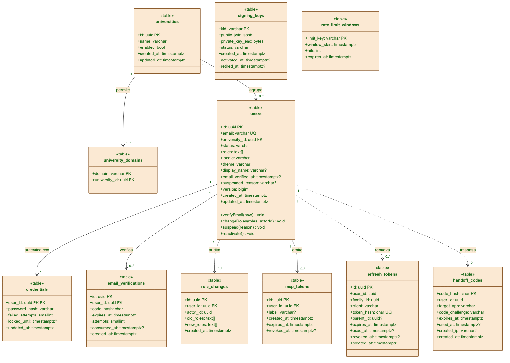
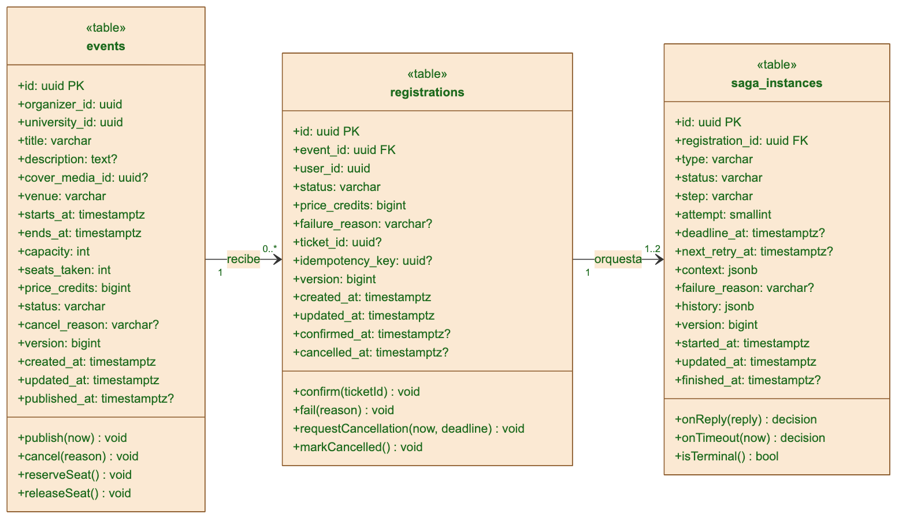
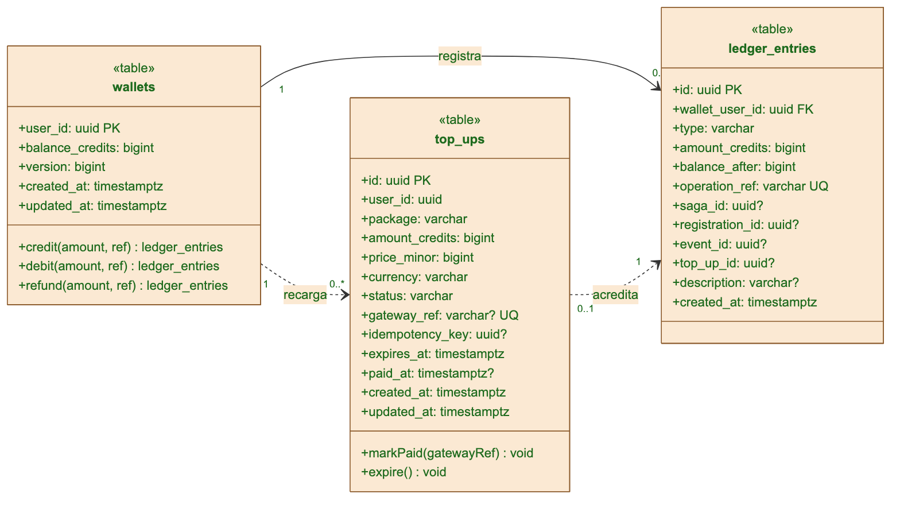
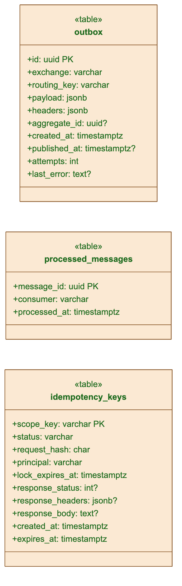
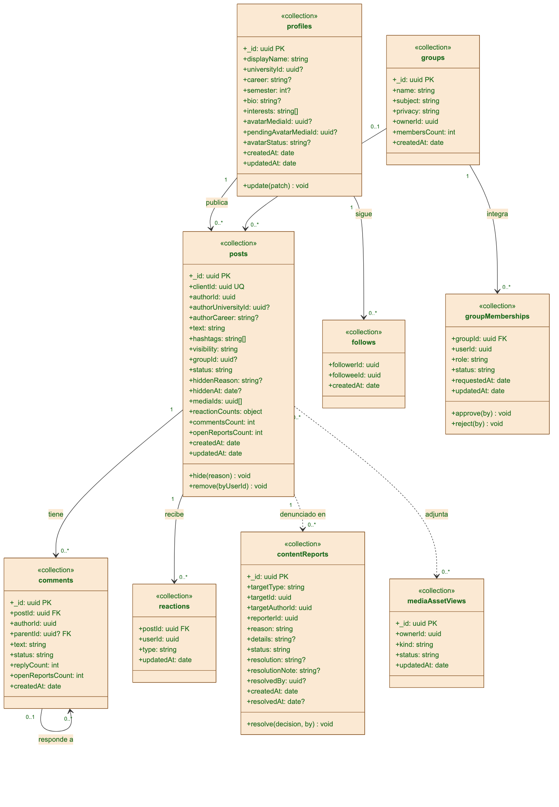
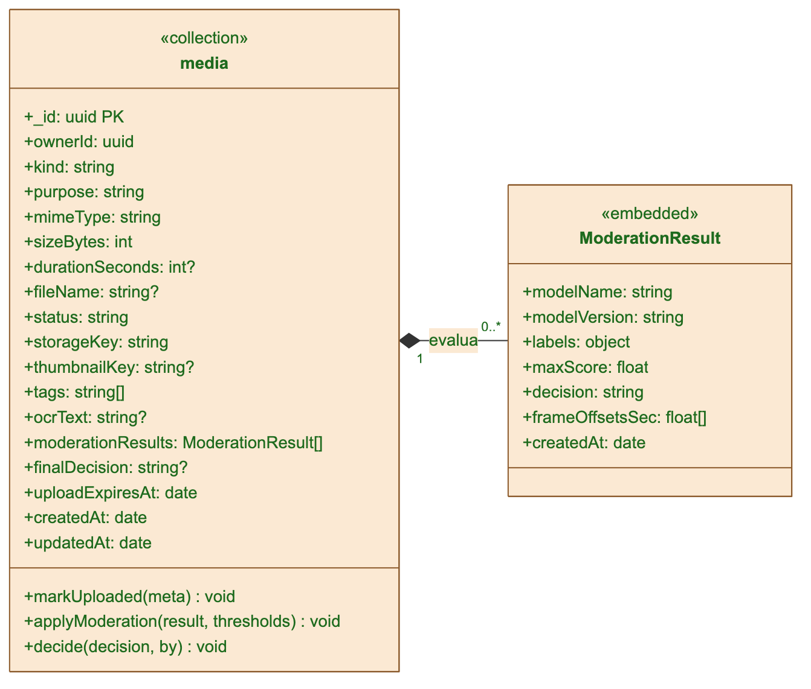
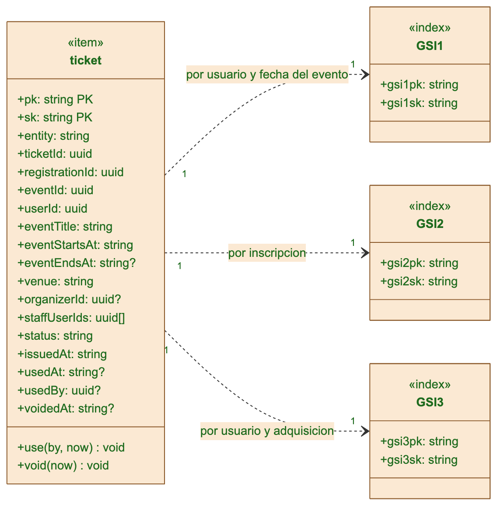
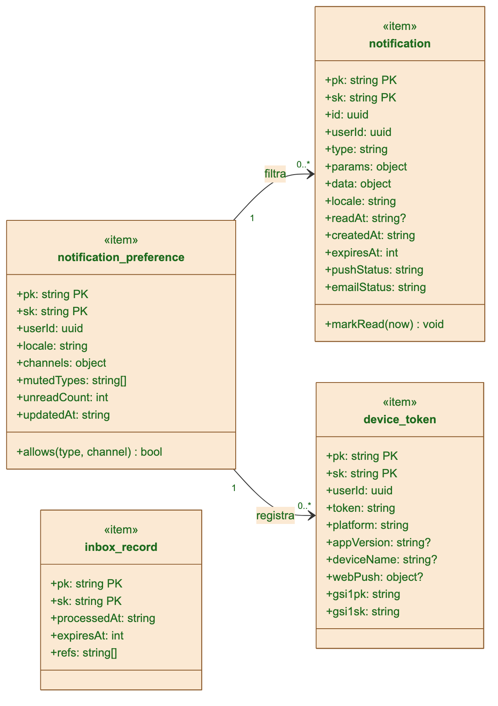
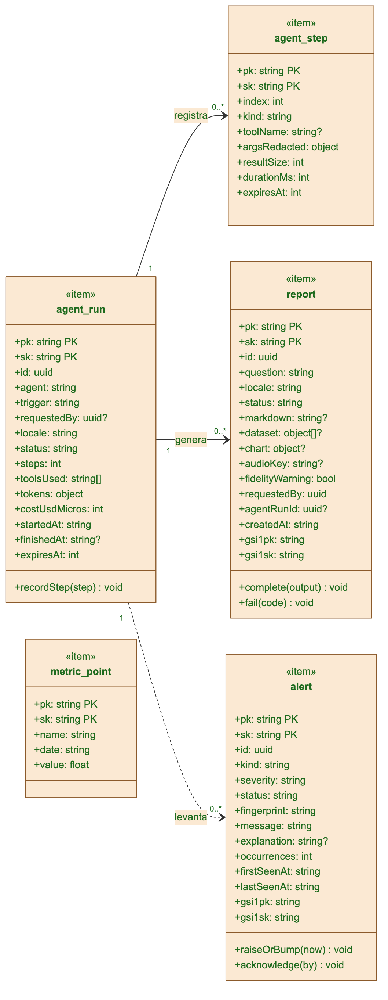
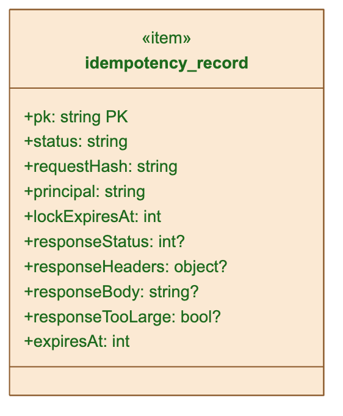

# Qué es este documento

Muestra cómo quedarán los **10 diagramas de clases UML 2.5** que crea el script `08-modelo-de-datos.js` en Enterprise Architect. Cada diagrama sale de las tablas, colecciones e ítems reales de una base de datos de Bandada U: una clase por tabla (`«table»`), colección (`«collection»`) o ítem de DynamoDB (`«item»`), con sus atributos, tipos, claves (`PK`, `FK`, `UQ`) y las asociaciones con nombre y multiplicidad.

**Importante.** Estas imágenes están dibujadas con Mermaid, con colores parecidos a los de EA, para revisar el *contenido*: clases, atributos y relaciones. No son una captura de EA. En EA, el script coloca las clases en una rejilla ajustada al tamaño de cada una y luego pide el autoacomodo del programa, así que la distribución exacta y el trazo de las líneas serán los de EA. Nadie ha ejecutado todavía el script en un EA real: quien lo corra primero debe revisar el resultado y avisar de lo que falle.

# Cómo generarlos en EA

1. En EA, abre una copia del proyecto y entra en *View › Scripting* (`Ctrl+Alt+8`).
2. Crea un script JScript nuevo, pega el contenido de `entregable/ea/scripts/08-modelo-de-datos.js` y pulsa *Run*.
3. En el *Project Browser* aparece el paquete **Bandada U - 08 Modelo de datos**, con un subpaquete por motor (PostgreSQL, MongoDB, DynamoDB) y los 10 diagramas.

Para regenerar el script después de cambiar `docs/02-iconix/06-modelo-estatico/modelo-datos.md`: `node entregable/ea/generar-scripts-ea.mjs`.

# Los diagramas

## 1. Identidad — identity_db (PostgreSQL)

{width=16.5cm}

## 2. Eventos — events_db (PostgreSQL)

{width=16.5cm}

## 3. Billetera — wallet_db (PostgreSQL)

{width=16.5cm}

## 4. Soporte común — outbox, inbox e idempotencia (PostgreSQL)

{height=20cm}

## 5. Social — social (MongoDB)

{height=20cm}

## 6. Medios — media (MongoDB)

{width=16.5cm}

## 7. Entradas — bandada-ticketing (DynamoDB)

{width=16.5cm}

## 8. Notificaciones — bandada-notifications (DynamoDB)

{height=20cm}

## 9. Insights — bandada-insights (DynamoDB)

{height=20cm}

## 10. Idempotencia compartida — bandada-idempotency (DynamoDB)

{height=20cm}
